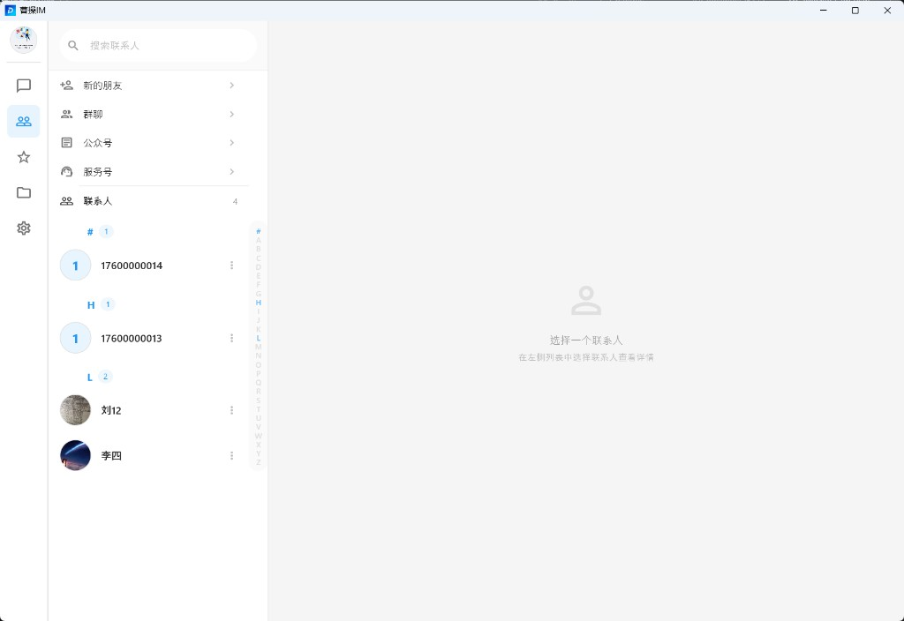
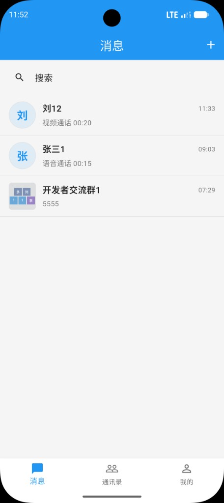
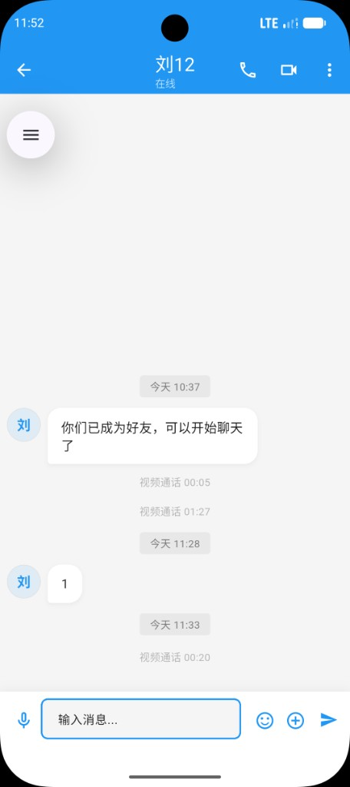
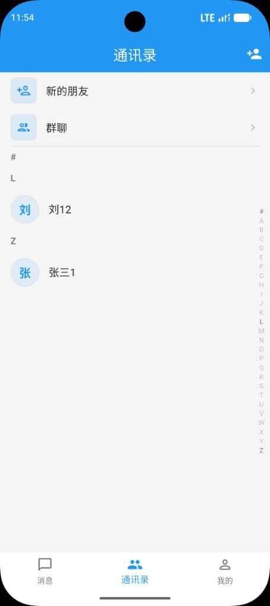
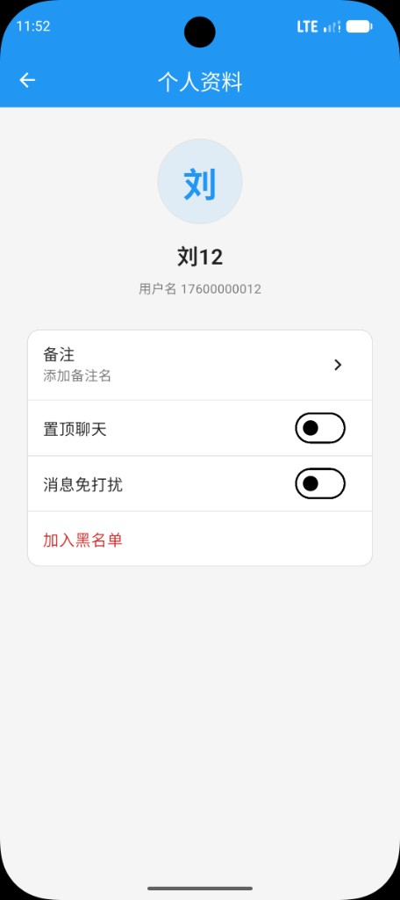
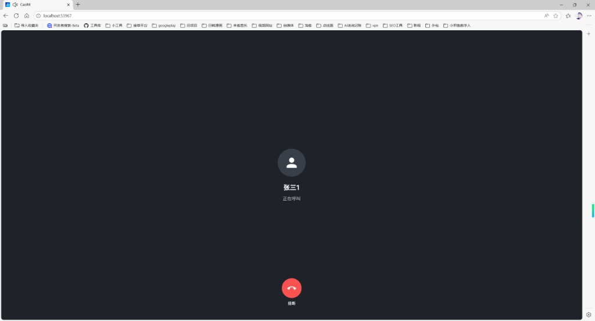

# app-server

CaoIM 的客户端应用服务。负责注册、登录、刷新应用 Token、修改个人资料，以及图片、语音、文件和短视频上传。消息、好友、群和长连接在 im-server。

默认端口 **8081**，没有额外的上下文路径。数据库 **`cao_im_app_server`**。

登录成功后返回：

- `token`：访问本服务，例如改资料、上传文件
- `imToken` / `imRefreshToken`：由 im-server 签发，客户端拿它连 `ws://{host}:8080/api/ws`

两套 Token 的密钥各自独立。本服务通过 Feign 调用 im-server，请求头带 `X-Internal-Token`。

## 仓库一览

| 仓库 | 作用 |
|------|------|
| im-server | 消息与长连接。好友、群、历史、已读、离线同步和一对一通话信令。端口 8080，库 `cao_im_db` |
| app-server | 本仓库。客户端注册、登录、个人资料和文件上传。端口 8081，库 `cao_im_app_server` |
| im-admin | 运营后台：用户启停、群、消息检索、敏感词、系统配置、角色和审计。API 端口 8082，页面开发端口 5173，库 `cao_im_admin` |
| im-sdk-flutter | Flutter SDK。负责 WebSocket、本地消息库、会话、群和通话信令，不包含界面 |
| flutter-demo | 客户端。同一套代码运行在 Windows、macOS、Android、iOS 和 Web |

## 客户端界面

登录、资料和文件都经过本服务。下面是客户端在 Windows、手机和浏览器上的界面。

### Windows

<table>
  <tr>
    <td align="center"><br/><b>会话列表</b></td>
    <td align="center"><br/><b>私聊</b></td>
  </tr>
  <tr>
    <td align="center"><br/><b>群资料</b></td>
    <td align="center"><br/><b>通讯录</b></td>
  </tr>
  <tr>
    <td align="center"><br/><b>联系人资料</b></td>
    <td align="center"><br/><b>语音呼叫</b></td>
  </tr>
  <tr>
    <td align="center" colspan="2"><br/><b>视频通话</b></td>
  </tr>
</table>

### App

<table>
  <tr>
    <td align="center"><br/><b>消息</b></td>
    <td align="center"><br/><b>私聊</b></td>
    <td align="center"><br/><b>通讯录</b></td>
    <td align="center"><br/><b>个人资料</b></td>
  </tr>
  <tr>
    <td align="center"><br/><b>表情</b></td>
    <td align="center"><br/><b>图片、视频、文件</b></td>
    <td align="center"><br/><b>语音呼叫</b></td>
    <td align="center"><br/><b>视频通话</b></td>
  </tr>
</table>

### Web

<table>
  <tr>
    <td align="center"><br/><b>群聊</b></td>
    <td align="center"><br/><b>群资料</b></td>
  </tr>
  <tr>
    <td align="center"><br/><b>通讯录</b></td>
    <td align="center"><br/><b>语音呼叫</b></td>
  </tr>
  <tr>
    <td align="center" colspan="2"><br/><b>视频来电</b></td>
  </tr>
</table>

## 功能

- 用户名注册、登录、刷新应用 Token
- 密码由客户端先做 MD5，服务端再以 BCrypt 入库
- 查询和修改昵称、头像等资料，并同步到 IM 用户
- 单文件和多文件上传
- 存储可切换：本地目录，或 S3 兼容的对象存储（配置名 `oss`，可接 MinIO、阿里云 OSS、腾讯云 COS）
- 探测 im-server 是否可连接

## 环境

| 环境 | 版本 |
|------|------|
| JDK | 17 及以上 |
| Maven | 3.6 及以上 |
| MySQL | 5.7 及以上 |

依赖 `com.caoim:im-core:1.0.0`。启动前要先在 `im-server` 执行 `mvn clean install -DskipTests`，并且 im-server 已经在运行。

## 本地启动

```bash
mysql -u root -p < sql/schema.sql

cd app-server
mvn spring-boot:run
```

`sql/schema.sql` 会 `DROP TABLE app_user` 再重建。已经有用户数据时不要重复执行。

改 `src/main/resources/application.yml`：

| 配置 | 说明 |
|------|------|
| `spring.datasource` | 库地址、账号、密码 |
| `jwt.secret` | 应用 Token 密钥，与 im-server 的密钥不是同一个 |
| `im.server.url` | im-server 地址，默认 `http://localhost:8080/api` |
| `im.server.internal-token` | 必须与 im-server 的 `im.internal-token` 一致 |
| `file.type` | `local`、`oss`、`cos` 或 `s3`。默认 `local` |
| `file.local-path` | 本地文件目录，默认 `./caoim-files` |
| `file.domain` | 拼进文件 URL 的访问前缀 |
| `file.max-size` | 单文件上限，默认 50MB。短视频按这个上限，普通文件由客户端限制为 10MB |
| `file.oss.*` | `type` 改为对象存储后填写 endpoint、bucket、密钥和 `public-url` |

手机打开发给它的图片时，`file.domain` 必须是手机能访问的地址。写成 `http://127.0.0.1:8081` 时，只有跑服务的那台电脑能打开文件。局域网调试改成电脑 IP，例如 `http://192.168.0.10:8081`。对象存储则把 `file.oss.public-url` 配成桶的公网或局域网访问地址。

接口文档：http://localhost:8081/swagger-ui/index.html

## 生产部署

```bash
mvn clean package -DskipTests
java -jar target/app-server-1.0.0.jar --spring.config.location=file:./config/application.yml
```

打包前确认 `im-core` 已安装到当前机器的本地 Maven 仓库，或已发布到构建所用的私服。

Nginx 示例职责：

- 把客户端的 `/api/` 反代到 `127.0.0.1:8081`
- `file.type=local` 时，保证 `file.domain` 指向这台服务，上传目录有写权限，并做好备份
- 使用对象存储时，桶需要能被客户端读取。`public-read: true` 时对象为公开读

允许的扩展名写在 `file.allowed-extensions`，包含常见图片、文档、音频和 mp4/mov/avi。

## 接口

| 方法 | 路径 | 说明 |
|------|------|------|
| POST | `/api/client/register` | 注册。密码字段传 MD5 |
| POST | `/api/client/login` | 登录，返回 `token`、`user`、`imToken` |
| POST | `/api/client/refresh-token` | 刷新应用 Token，头里带旧的 Bearer Token |
| GET | `/api/user/info` | 当前用户资料 |
| PUT | `/api/user/profile` | 修改资料 |
| POST | `/api/file/upload` | 上传一个文件 |
| POST | `/api/file/uploads` | 上传多个文件 |
| GET | `/api/im/connection/health` | im-server 是否可达 |

上传和资料接口需要应用 Token。登录、注册不需要。

## 目录

```
app-server/
├── sql/schema.sql
└── src/main/java/com/caoim/appserver/
    ├── controller/     # AuthController、FileController、ImConnectionController
    ├── service/        # 用户、文件、与 im-server 的桥接
    └── config/         # Security、JWT、CORS、存储
```

## 联系与支持

有新功能、定制开发或合作意向，欢迎扫码加微信私信。

独立开发不易。如果这个项目对你有帮助，也可以通过微信或支付宝支持一下，你的认可是我继续更新的动力。

<table>
  <tr>
    <td align="center"><br/><b>微信</b><br/>定制与合作</td>
    <td align="center"><br/><b>微信支付</b></td>
    <td align="center"><br/><b>支付宝</b></td>
  </tr>
</table>

## License

MIT License
